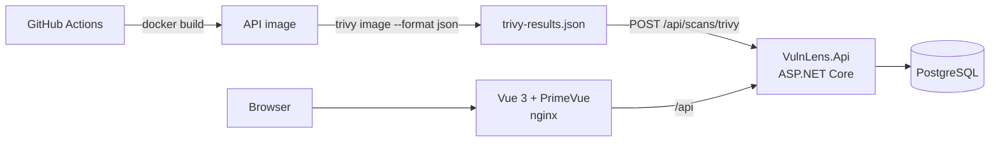

# VulnLens

   

**VulnLens collects container vulnerability scan reports (Trivy), de-duplicates them and shows what changed between scans.**
It scans **its own Docker image** in CI and can send the result to itself (dogfooding).

> Built with .NET 10, ASP.NET Core minimal APIs, EF Core + PostgreSQL, Vue 3 + PrimeVue, Docker and GitHub Actions.

## Why

Scanners like Trivy produce large JSON reports per image and per run. Teams usually need simpler answers:

- *Which critical/high issues are open right now, across all images?*
- *What got fixed since the last build, and what is new?*

## Architecture



| Project | Responsibility |
|---|---|
| `VulnLens.Core` | Domain model (`Scan`, `Finding`, `Severity`), report parsers, fingerprinting. No framework dependencies. |
| `VulnLens.Infrastructure` | EF Core `DbContext`, PostgreSQL mapping, DB initialization. |
| `VulnLens.Api` | Minimal API endpoints, ingestion API key, OpenAPI document. |
| `frontend/` | Vue 3 + PrimeVue dashboard (scans, latest findings, scan diff, upload). |
| `tests/VulnLens.Tests` | Unit tests for parsing and de-duplication. |

### De-duplication

Each finding gets a **fingerprint** = SHA-256 of `artifact | CVE | package | installed version`.
The same CVE reported for several targets of one image is stored once (unique index on `ScanId + Fingerprint`),
and comparing fingerprints of two scans gives the *new* and *fixed* lists (`GET /api/diff`).

## Run it

```bash
docker compose up --build
```

- UI: http://localhost:3000
- API: http://localhost:8080 (OpenAPI: `/openapi/v1.json`, health: `/health`)

Load the sample report:

```bash
curl -X POST --data-binary @samples/trivy-sample.json -H "Content-Type: application/json" http://localhost:8080/api/scans/trivy
```

Or scan a real image and upload it:

```bash
trivy image --format json --output trivy-results.json nginx:latest
curl -X POST --data-binary @trivy-results.json -H "Content-Type: application/json" http://localhost:8080/api/scans/trivy
```

### Local development

```bash
docker compose up -d db                      # PostgreSQL only
dotnet run --project src/VulnLens.Api        # API on :8080
cd frontend && npm install && npm run dev    # UI on :5173 (proxies /api)
dotnet test VulnLens.slnx
```

## API

| Method | Route | Description |
|---|---|---|
| `POST` | `/api/scans/{scanner}` | Import a raw report (`trivy`). Requires `X-Api-Key` if `Ingest:ApiKey` is set. |
| `GET` | `/api/scans` | Latest 100 scans with severity counts. |
| `GET` | `/api/scans/{id}/findings` | Findings of one scan. |
| `GET` | `/api/findings?minSeverity=High&artifact=` | Findings of the latest scan of each artifact. |
| `GET` | `/api/diff?artifact=` | New / fixed findings between the last two scans of an artifact. |

## CI pipeline

1. Build and test the .NET solution, build the frontend.
2. Build the API Docker image and scan it with Trivy (JSON report as a build artifact).
3. If `VULNLENS_URL` and `VULNLENS_API_KEY` secrets are set, upload the report to a running VulnLens instance.
4. Security gate for fixable CRITICAL issues (report-only for now).

## Roadmap

- [x] EF Core migrations instead of `EnsureCreated`
- [x] Integration tests with `WebApplicationFactory` + Testcontainers (PostgreSQL)
- [ ] SARIF and Grype parsers
- [ ] Watched-folder import with a `BackgroundService`
- [ ] Trend chart (findings per severity over time)
- [ ] SonarCloud quality gate, Stryker.NET mutation testing
- [ ] Public demo deployment
